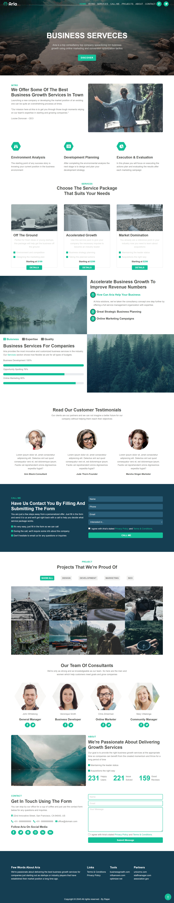

<div align="center">

# ✨ ARIA — Business Growth & Consultancy

### A modern, responsive business landing page built with Bootstrap

<p>
  
  
  
  
</p>

<p>
  <b>A clean and responsive business website created for frontend development practice.</b>
</p>

</div>

---

## 📌 About the Project

**Aria** is a business consultancy landing page designed to present services, projects, team members, and customer feedback in a professional layout.

The project focuses on responsive design, reusable sections, interactive UI elements, and a smooth browsing experience.

---

### 🖥️ Responsive Previews (Optional)
| Desktop View |
| :---: |
|  |
---

### 📱 Responsive Previews (Optional)
| Tablet | Mobile |
| :---: | :---: |
|  |   |

---

## 🎥 Project Video Demo

https://github.com/user-attachments/assets/0911d50d-58d1-42ab-9648-a7085a9a9593

## 🌟 Features

- Responsive navigation with section links
- Hero section with animated heading text
- Introduction and business overview
- Service cards and business growth content
- Customer testimonials carousel
- Contact / callback form sections
- Project gallery with category filters
- Team members carousel
- About section with statistics
- Contact details and social media links
- Smooth back-to-top button
- Responsive layout for desktop, tablet, and mobile screens

## 🧰 Tech Stack

| Technology | Purpose |
| --- | --- |
| HTML5 | Website structure |
| CSS3 | Custom styling and responsive design |
| Bootstrap 5.3.8 | Layout and utility classes |
| JavaScript | Interactive functionality |
| jQuery 3.7.1 | JavaScript library |
| Owl Carousel 2.3.4 | Testimonials and team sliders |
| Font Awesome 6.7.2 | Icons |

## 📁 Project Structure

```text
Aria/
├── css/
│   ├── style.css
│   └── media.css
├── js/
│   └── carousel.js
├── img/
│   └── website images and icons
├── screenshots/
│   ├── desktop.png
│   ├── tablet.png
│   └── mobile.png
└── index.html
```

## 🚀 Run Locally

1. Clone or download this repository.
2. Open the project folder in Visual Studio Code.
3. Open `index.html` in your browser.

For live preview and automatic refresh, use the **Live Server** extension.

## 📱 Responsive Design

The layout is made to adapt to different screen sizes using Bootstrap utilities and custom CSS media queries.

- **Desktop:** Full navigation and multi-column layouts
- **Tablet:** Adjusted spacing and section layouts
- **Mobile:** Compact content and mobile-friendly navigation

## 🎯 What I Practiced

- Building a complete landing page with HTML and CSS
- Using Bootstrap components and utility classes
- Creating responsive layouts with media queries
- Integrating Owl Carousel
- Organizing project files and assets
- Improving UI consistency and frontend workflow

## 👨‍💻 Author

**Rajan Kumar Tiwari**

- GitHub: [@Heytiwari](https://github.com/Heytiwari)

---

<div align="center">

### 💙 Thanks for checking out this project!

*Made with focus, practice, and a passion for frontend development.*

</div>
